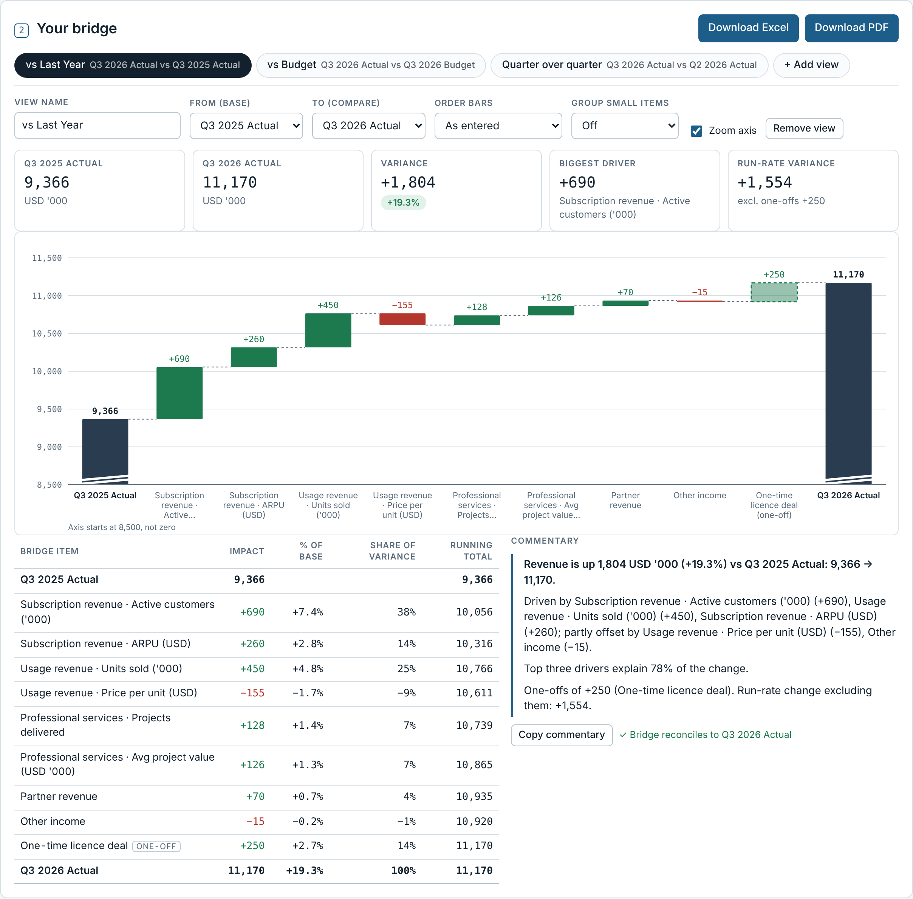
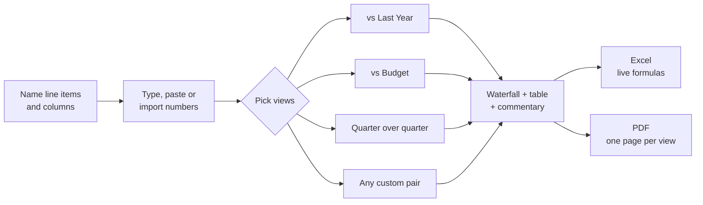
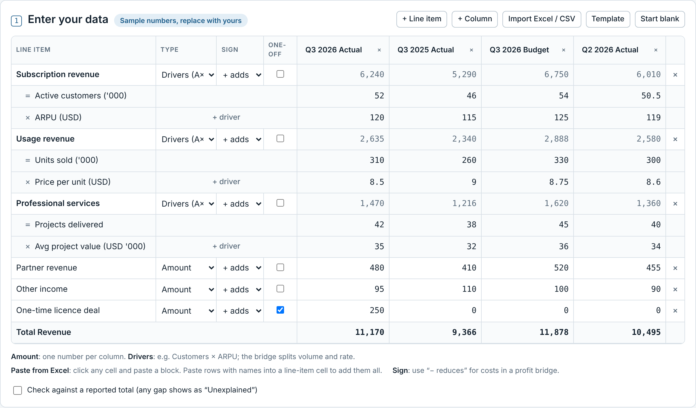
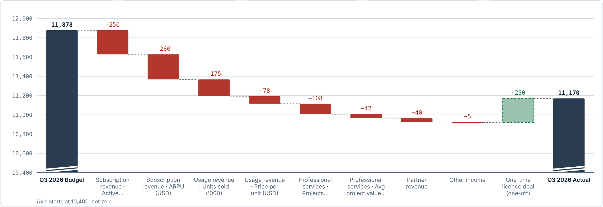
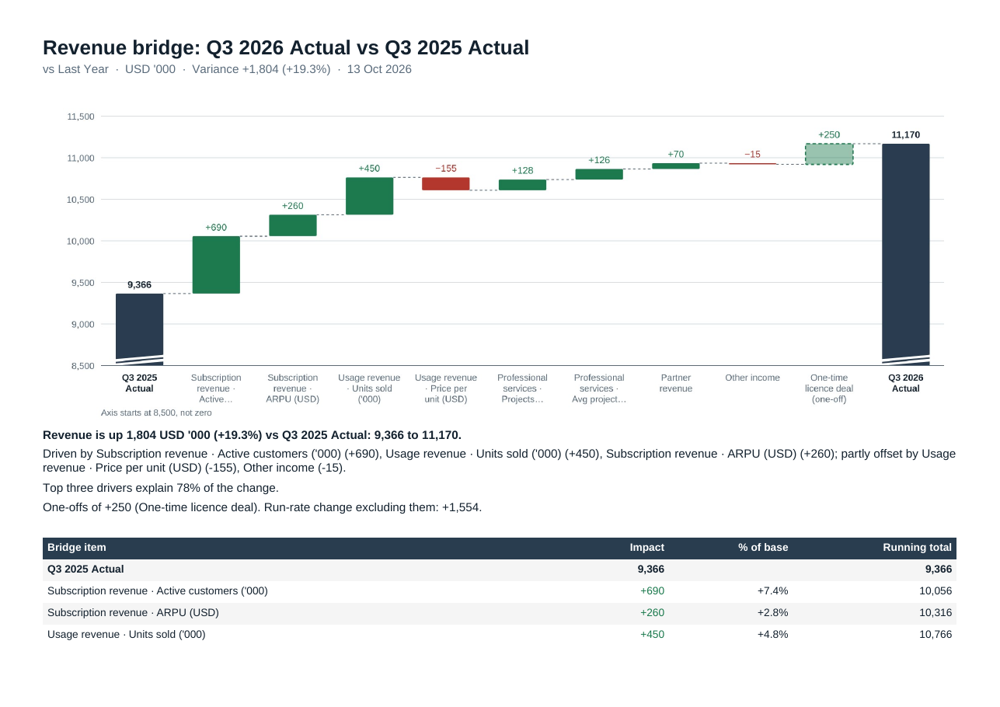

# Bridge Builder

**Variance bridges for FP&A, without the spreadsheet plumbing.** Name your line items, paste the numbers, and get a reconciled waterfall for every view you report: this year vs last year, actual vs budget, and quarter over quarter. Export to Excel (with live formulas) or PDF.

> All screenshots use the built-in **fictional sample company**. They are not real figures.

---

## How it works

You enter the data **once**. Every view is built from the same grid, so the bridges always agree with each other.

## 1. Enter your data like a spreadsheet

| You can… | How |
|---|---|
| **Name anything** | Rename columns to your periods (`Q3 2026 Actual`, `Q3 2026 Budget`…) and line items to your P&L lines. |
| **Use amounts** | One number per column. The bar is the change. |
| **Use drivers** | `Customers × ARPU`, `Units × Price`, up to 4 drivers. Each driver gets its own bar. |
| **Model costs** | Set the sign to `− reduces` to build a profit or EBITDA bridge. |
| **Flag one-offs** | Shown as dashed bars. Commentary gives the run-rate variance without them. |
| **Paste from Excel** | Click a cell and paste a block. Paste `name + values` rows into a line-item cell to add many lines at once. |
| **Import a file** | `.xlsx` or `.csv`: first row = column names, first column = line items. A row starting with `Total` becomes the reported total. Download **Template** to get the layout. |
| **Tie to the close** | Tick *Check against a reported total*. Any gap shows as an **Unexplained** bar, never a hidden plug. |

## 2. Get the bridge for every view

Switch between views with the tabs, or add your own (e.g. *Forecast vs Budget*). Each view shows:

- **Headline numbers**: base, compare, variance %, biggest driver, run-rate variance
- **Waterfall** with green increases, red decreases and dashed one-offs (axis zoom is optional and always labelled)
- **Bridge table** with impact, % of base, share of variance and running total
- **Auto commentary** ready to paste into an email or deck, plus a ✓ check that the bridge reconciles
- **Readability options**: sort bars by impact, group small movements into *Other*

## 3. Download Excel or PDF

| Excel | PDF |
|---|---|
| `Inputs` sheet plus one sheet per view | One landscape page per view |
| Live formulas, so the controller can audit every cell | Chart, commentary and bridge table |
| `Check (should be 0)` row on every bridge | Ready for the board pack |
| Floor / Down / Up helper columns for a native Excel waterfall | |

---

## The method

Driver lines use **sequential substitution**. For `Value = A × B × C`, compared from base (₀) to compare (₁):

| Bar | Formula | Reads as |
|---|---|---|
| A | (A₁ − A₀) × B₀ × C₀ | volume at the old rates |
| B | A₁ × (B₁ − B₀) × C₀ | rate change on the new volume |
| C | A₁ × B₁ × (C₁ − C₀) | last driver on new volume and rate |

The bars add up exactly to `A₁B₁C₁ − A₀B₀C₀`, so **every bridge reconciles by construction**. Order the drivers volume first, then price or rate, which is the usual FP&A convention.

## Run it

- **No install.** Open `index.html` in any modern browser.
- **Private by design.** Data is saved in your own browser only and is never uploaded.
- **Editing.** Change `bridge-builder.html`, then run `python3 build.py` to regenerate `index.html`.

| File | What it is |
|---|---|
| `bridge-builder.html` | The app (also published as a claude.ai artifact) |
| `index.html` | Standalone version generated by `build.py` |
| `docs/` | README screenshots (fictional sample data) |
